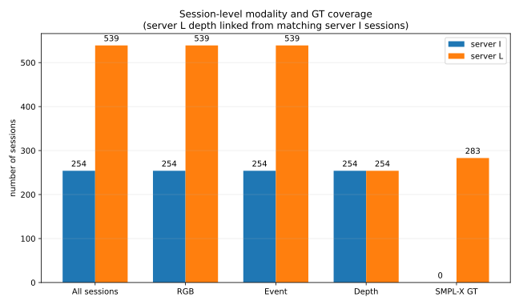
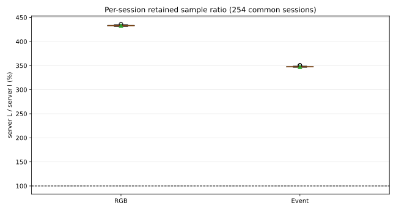
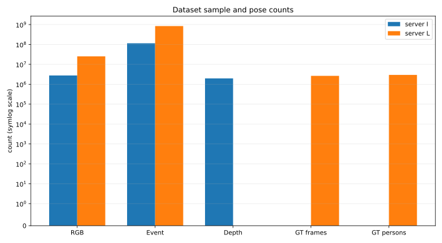

# EventPose 데이터셋 세션 단위 구성 및 통계

분석 시각: 2026-10-23 (Asia/Seoul)  
명칭: `orig_dataset/` = **server I**, `dataset/` = **server L**  
상세 원자료: [server_i_sessions.csv](server_i_sessions.csv), [server_l_sessions.csv](server_l_sessions.csv)

## 먼저 보는 세션 단위 핵심 결과

여기서 **세션 1개는 한 번의 연속 촬영 폴더, 즉 여러 카메라 비디오를 묶은 촬영 1건**을 뜻한다. 아래 표는 프레임 수가 아니라 해당 데이터를 하나 이상 보유한 세션 수다.

| 보유 데이터 기준 | server I | server L |
|---|---:|---:|
| 전체 촬영 세션 | **254** | **539** |
| RGB가 있는 세션 | 254 (100%) | 539 (100%) |
| Event가 있는 세션 | 254 (100%) | 539 (100%) |
| Depth가 있는 세션 | 254 (100%) | **254 (47.1%, server I에서 연결)** |
| SMPL/SMPL-X GT가 있는 세션 | **0 (0%)** | **283 (52.5%)** |

server L 자체에는 Depth 이미지가 없지만, 양쪽에 공통으로 존재하는 254개 세션은 동일 세션명의 server I `RGBD/streams/depth_align`을 연결해 사용하는 것으로 집계했다. server L에만 있는 나머지 285개 세션은 server I에 대응 세션이 없으므로 연결 가능한 Depth가 없다.

가장 중요한 해석은 다음과 같다.

- server I의 모든 세션에는 RGB, Event, Depth가 모두 있지만 GT는 없다.
- server L의 모든 세션에는 RGB와 Event가 있고 자체 Depth는 없다. 공통 세션 254개에는 server I의 Depth를 연결할 수 있다. 이 중 283개 세션에 SMPL-X GT가 있고 256개에는 GT가 없다.
- server L의 MAMMA GT는 **SMPL-X**다 (`schema_name=Busan26_MAMMA_posed_SMPLX`). `params/smplx_pose_axis_angle`은 `(frame, person, 165)`, `params/smplx_betas`는 `(frame, person, 16)`, mesh는 10,475 vertices다.
- GT 파일은 보통 장치별로 같은 동기화 타임라인을 투영해 저장하므로, 학습 타깃의 시간적 개수를 알고 싶을 때는 `GT 고유 타임스텝`을 사용해야 한다. 카메라 관측별 레코드 양을 알고 싶을 때만 `GT 카메라별 프레임 레코드`를 사용한다.
- `GT 유효 human pose 인스턴스`는 canonical device(우선 device0)의 `results/person_valid=True` 합이다. 한 프레임에 사람이 2명이면 2개로 센다.

## 데이터 구조 차이

### server I: 원본 동기화 HDF5

- `data1/`, `data2/`, `data3/`는 요청대로 구분을 무시하고 합쳤다. 동일 세션명이 여러 partition에 있으면 한 번만 집계했다.
- 세션 아래 `RGBD/device0..4.h5`, `RGB/device5..6.h5`, `Event/device0..6.h5` 형태가 기본이다.
- RGBD 한 파일 안에는 `streams/rgb`와 `streams/depth_align`이 함께 있다. 독립 RGB 카메라는 `streams/images`, Event도 `streams/images`다.
- 대표 해상도는 RGBD RGB 3840×2160, 독립 RGB 1700×1300, Event 960×720이다. RGB는 JPEG, Event는 PNG frame encoding이다.
- RGBD/RGB/Event 영상은 이미 undistort 및 device0-master synchronization된 temporal subset이다. Event는 RGB anchor마다 여러 context frame을 가진다.
- 조사된 HDF5 dataset path에 SMPL/pose 항목이 없어 human-pose GT는 0으로 판정했다.

### server L: 압축/샤딩 데이터 + MAMMA GT

- RGB는 `RGB/deviceN/images.h5`로 리사이즈·JPEG 압축되어 있고, Event는 장치별 `frames_*.npz` 및 `events_*.npz` shard로 나뉜다. `conversion_manifest.json`의 실제 frame count를 집계했다.
- 실제 RGB stream은 1280×720, JPEG quality 95다. Event frame shard와 sparse event payload shard는 5,000-frame 단위가 기본이다.
- 변환 manifest의 출력은 대체로 RGB/Event 장치 0..4다. server I의 별도 RGB/Event 장치 5,6은 server L 변환 대상에서 빠진다.
- Depth는 변환 설정 `depth_included=false`인 경우 제거된다. 위 표의 server L Depth는 실제 `streams/depth_align` 존재 여부로 검증한 값이다.
- `RGBD/deviceN_mamma.h5`가 SMPL-X GT다. pose parameters, world translation, camera/world vertices, bbox, person mask, 동기화 인덱스를 포함한다.
- GT의 `source_depth_*`와 `synchronization/rgbd_depth_align/*`는 원천 Depth를 참조하는 인덱스/메타데이터이지, server L에 Depth 영상 샘플 자체가 남았다는 뜻은 아니다.

## 세션 대응 및 보존율

| 항목 | 개수 |
|---|---:|
| 양쪽에 공통인 세션 | 254 |
| server I에만 있는 세션 | 0 |
| server L에만 있는 세션 | 285 |
| server L conversion `success=true` | 539 / 539 |
| server L에 MAMMA GT가 있는 세션 | 283 / 539 |
| server I partition 간 중복 세션명 | 0 |

공통 254개 세션만 제한하면 server L에서 RGB/Event 보유 세션은 모두 254개이고, 이 전부에 server I Depth를 연결할 수 있다. GT 보유 세션은 171개이며 나머지 83개 공통 세션에는 GT가 없다. server L에만 있는 285개 세션 중 GT 보유 세션은 112개, GT가 없는 세션은 173개다.

보존율 그래프는 공통 세션마다 `(server L 장치 합 프레임)/(server I 장치 합 프레임)`을 계산한 것이다. server L은 단순 포맷 변경판이 아니라 장치 선택과 temporal coverage가 다른 파생 데이터이므로 100%가 보장되지 않는다.

## 프레임 수 참고 부록

사용자가 요청한 주 집계 단위는 세션이므로 위 표를 우선 사용한다. 실제 학습 샘플 규모가 필요할 때 참고할 원래 frame-level 총량은 다음과 같다.

| 프레임/인스턴스 기준 | server I | server L |
|---|---:|---:|
| RGB 이미지 (모든 장치 합) | 2,758,546 | 25,302,879 |
| Event 프레임 (모든 장치 합) | 114,512,987 | 843,253,464 |
| Depth 프레임 (모든 장치 합) | 1,970,390 | 1,970,390 (server I 연결분) |
| GT 고유 타임스텝 | 0 | 2,646,391 |
| GT 유효 human-pose 인스턴스 | 0 | 2,948,298 |

## 집계 정의와 주의점

1. **RGB**: server I에서는 RGBD의 `streams/rgb`와 별도 RGB의 `streams/images`를 모두 합산했다. server L에서는 `RGB/device*/images.h5`의 실제 `streams/images` 수를 사용했다.
2. **Event**: event packet의 개수가 아니라, 모델 입력/시각화에 쓰이는 누적 Event **프레임 이미지 수**다. server L의 `events_*.npz`는 같은 프레임의 sparse event payload이므로 `frames_*.npz`와 중복해서 더하지 않았다.
3. **Depth**: 정렬된 `depth_align` 이미지 프레임 수다. server L 열에는 공통 254개 세션에 연결한 server I의 Depth를 표시했다. GT 파일 안의 depth position은 영상이 아니므로 별도 영상으로 세지 않았다.
4. **GT frame**: MAMMA 결과 행 수다. 여러 장치 파일에 반복된 같은 synchronized frame은 canonical device 한 개만 세어 unique timeline을 구했다.
5. **GT pose**: `person_valid`가 참인 사람-프레임 쌍이다. `success`만 세면 사람 수가 반영되지 않아 별도로 구분했다.
6. 개별 세션의 장치 누락, frame count, GT count는 두 CSV에서 확인할 수 있다.

## 참고 스크립트와의 관계

- `visualize_data.py`의 정의처럼 HDF5 image count는 `count` 또는 `len(offsets)-1`이며, RGB/Depth/Event stream을 같은 방식으로 셌다.
- `event_to_sparse.py`는 Event 한 프레임을 CSR 한 행으로 변환하므로 sparse payload 수가 아니라 CSR row/frame 수가 샘플 정의다.
- `compress_data.py`는 RGBD의 `depth_align`과 RGB context stream을 제거하고 주 RGB를 1280x720으로 줄이는 변환이다. server L은 별도 변환 schema지만, 원본 대비 stream 제거/리사이즈라는 차이를 해석할 때 이를 반영했다.
- `warp_rgbd_h5_to_event.py`가 보여주듯 server I의 RGBD RGB와 depth_align은 같은 pixel plane이며 calibration/synchronization으로 Event plane과 연결된다.

## 검증 상태

- HDF5는 이미지 payload를 디코딩하지 않고 dataset shape/offset/manifest를 읽어 집계했다.
- 읽기 오류: server I 0건, server L 0건. 오류 목록은 [scan_errors.txt](scan_errors.txt)에 기록했다.
